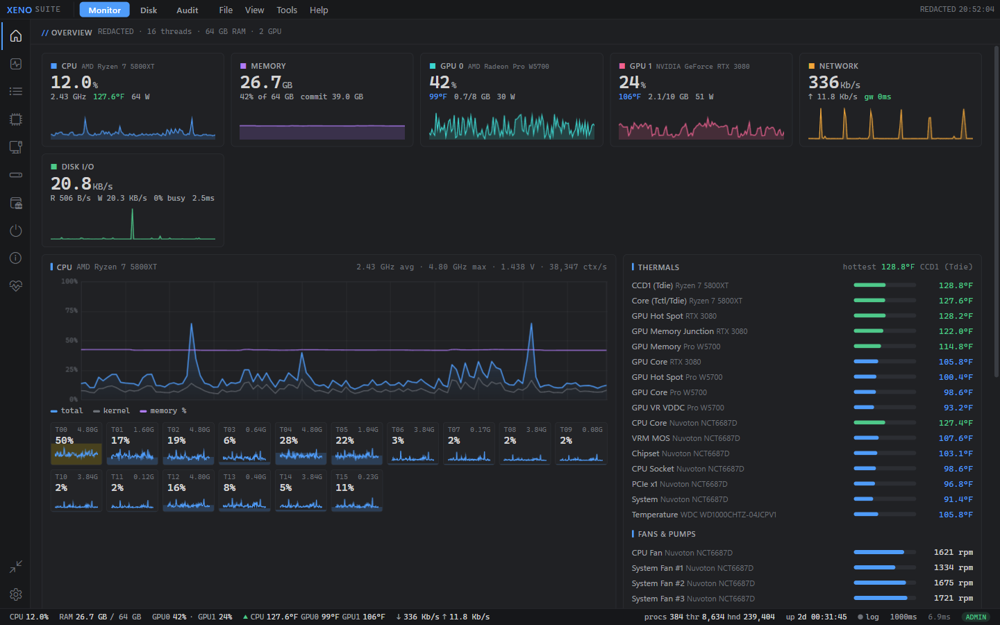
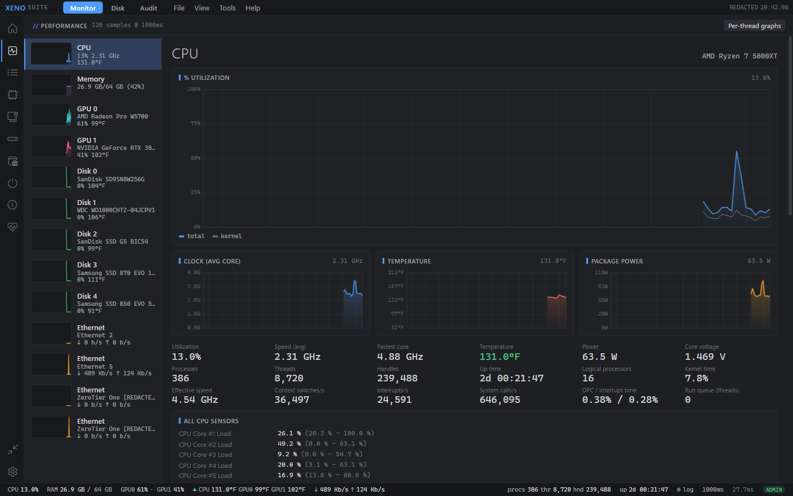
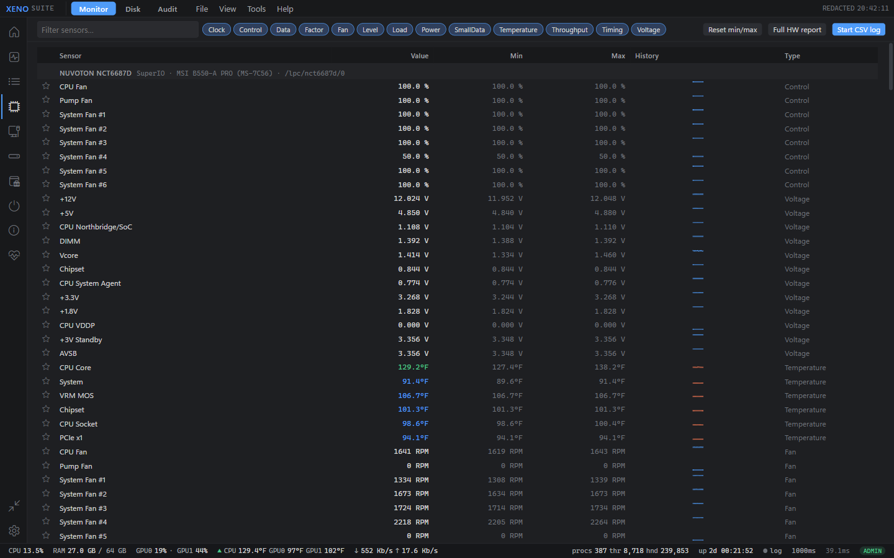
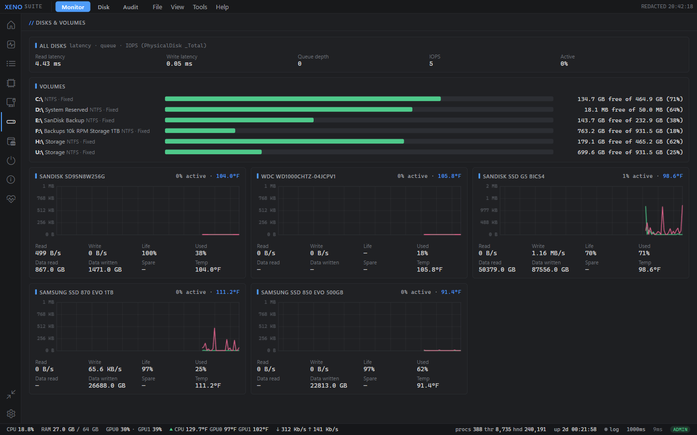
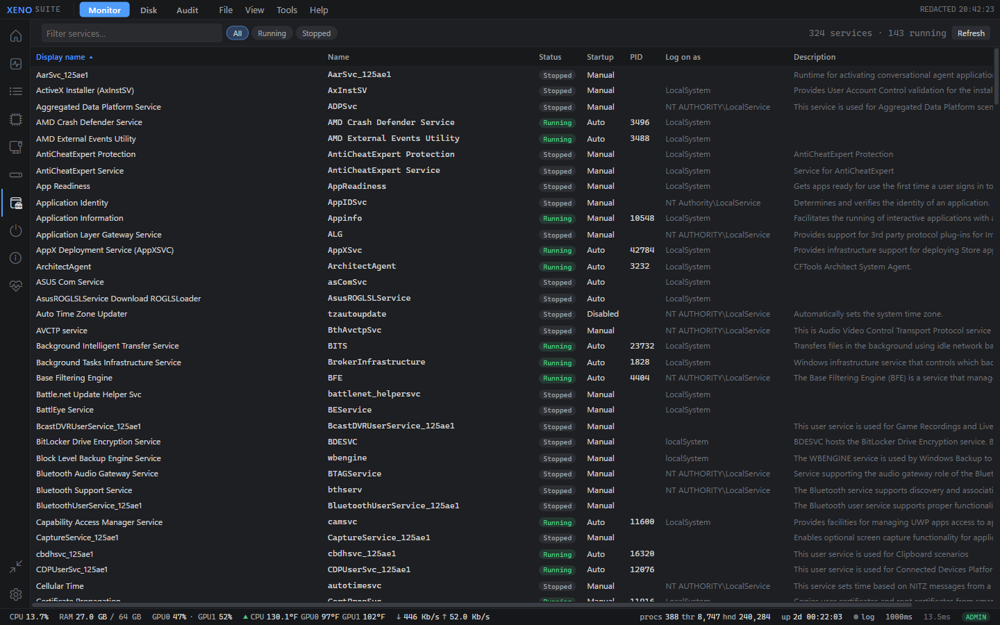
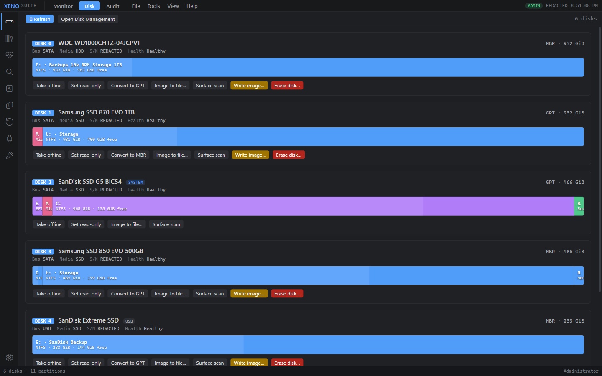
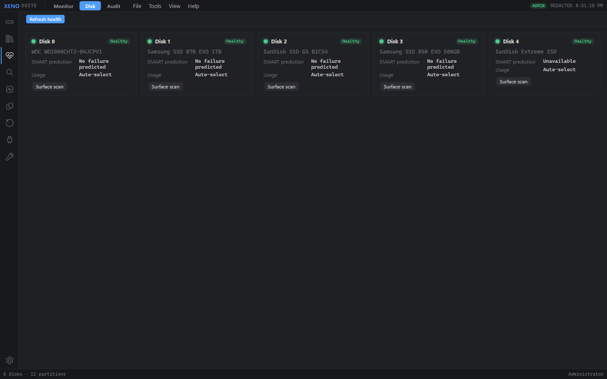
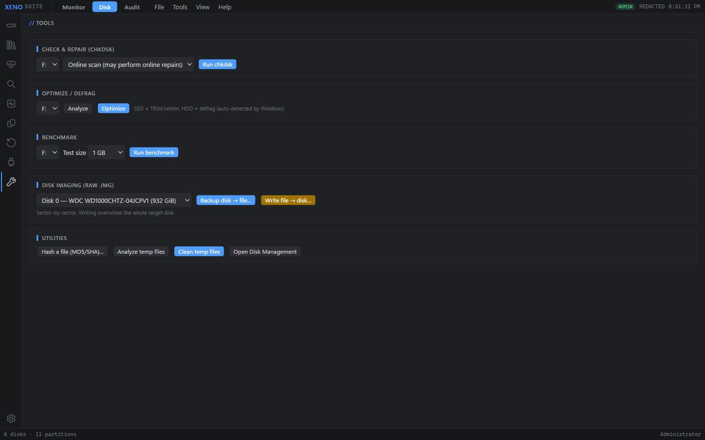

# XenoSuite

A Windows system toolkit by **Xeno**: a live hardware/system monitor, a full disk manager with health,
recovery and imaging tools, and a security-audit front end, in one app.
C# .NET 8 WPF host with a WebView2 UI.



> Screenshots are from a real PC. Serial numbers, machine name, IP/MAC addresses and similar identifiers
> are replaced with `REDACTED` / `x.x.x.x`.

---

## Modules at a glance

| Module | What it's for |
|---|---|
| [**Monitor**](#monitor) | Live CPU, memory, GPUs, disks, network, temperatures, fans; processes, services, startup apps; system report |
| [**Disk**](#disk) | Partitions and volumes, SMART health, surface scans, file finder, duplicates, space analysis, recovery, USB tools, imaging, benchmarks |
| [**Audit**](#audit) | Runs a security-audit scanner and shows its graded report |

Switch modules with the tabs at the top. Everything runs locally; nothing is sent anywhere.

---

## Monitor



| Page | Functions |
|---|---|
| **Overview** | One-screen dashboard: CPU, memory, each GPU, network and disk I/O cards with sparklines; per-thread CPU load; hottest-first thermal list; fans and pumps |
| **Performance** | Task-Manager-style detail per device (CPU, memory, every GPU, every disk, every network adapter): history charts, clocks, power, temperature, utilization, handles/threads, interrupts, DPC time, run queue, all raw CPU sensors |
| **Processes** | Full process list: CPU, memory, commit, GPU and VRAM, disk read/write, threads, handles, priority, user, session, start time, path; **end, suspend, resume**, change **priority** and **CPU affinity**, loaded modules, open file location |
| **Sensors** | Every hardware sensor (via LibreHardwareMonitor): temperatures, voltages, fan RPM and duty, clocks, loads, power; min/max tracking, favorites, filters by type, full hardware report, **CSV logging** |
| **Network** | Adapters with live throughput, active **TCP connections** per process, **latency targets** (gateway + your own hosts, pinged every 2 s), DNS lookup |
| **Disks** | Per-volume free space, per-disk live read/write charts, latency, queue depth, IOPS, drive life, total data written, temperature |
| **Services** | All Windows services with status, startup type, PID, account and description; **start, stop, restart, pause, continue** |
| **Startup** | Programs that start with Windows (registry Run keys and Startup folders) with **enable/disable** |
| **System** | Hardware and OS report: board, BIOS, CPU, memory modules, GPUs, drives, OS build |
| **Health** | Quick system health summary |
| **Mini mode** | A compact always-on-top bar with the key numbers |
| **Settings** | Sample interval, always-on-top, theme, title bar, logging |







---

## Disk



| Page | Functions |
|---|---|
| **Disks** | Every physical disk with bus, media type, partition style, health and a partition map. **Create, delete, resize and format** partitions; set **label**, **drive letter** and partition **attributes** (active/hidden/read-only); **initialize**, **clear** and **convert MBR ⇄ GPT**; take a disk **offline/online** or make it **read-only** |
| **Volumes** | Volume list with **repair** (online scan / spot fix / full), **optimize** (TRIM for SSDs, defrag for HDDs) and **BitLocker** status |
| **Health** | SMART failure prediction per drive and a non-destructive **surface scan** for bad sectors |
| **Finder** | Fast file search by name, size, date and type across a folder or drive; send results to the **Recycle Bin**, **move** or **copy** them |
| **Space** | Folder-size analyzer: what's using the space, drill-down tree and breakdown by file type |
| **Duplicates** | Finds duplicate files by content hash |
| **Recover** | Restore from the **Recycle Bin**, browse and restore from **Volume Shadow Copies** (and create a new snapshot), list a file's previous versions |
| **USB** | Safely **eject**, toggle the system-wide **USB write-protect** policy, and run a **capacity test** that catches fake-capacity flash drives |
| **Tools** | **chkdsk**, optimize/defrag, sequential read/write **benchmark**, sector-by-sector **disk imaging** to and from `.img` with verification, **file hashing** (MD5/SHA), **temp-file cleanup** (with a dry run first) |





Long operations (scans, imaging, benchmarks, searches) run as background jobs with progress and can be cancelled.

> ⚠️ Partition, format, clear, convert and image-write operations change disks for real. They are confirmed
> before running; double-check the disk number.

---

## Audit

A front end for a separate security-audit scanner (`VulnAudit.exe`): shows whether it's installed, runs a scan,
and displays the graded report (A–F with high/medium/low findings) or opens the full HTML report.
Point XenoSuite at the scanner once and it remembers the location.

---

## Requirements

- Windows 10 or 11 (x64)
- [.NET 8 Desktop Runtime](https://dotnet.microsoft.com/download/dotnet/8.0) and WebView2 (built into Windows 11)
- **Run as administrator** for full functionality: hardware sensors, SMART, disk management and service control need it

## Build

```
dotnet build -c Release -o dist
```

Needs the .NET 8 SDK. Hardware sensors come from
[LibreHardwareMonitor](https://github.com/LibreHardwareMonitor/LibreHardwareMonitor).

## Project layout

| Path | Contents |
|---|---|
| `MainWindow.xaml.cs`, `Api.cs` | WebView2 host and the bridge between the UI and the C# back end |
| `Sampler.cs`, `Counters.cs`, `HwSensors.cs`, `Proc.cs` | Live monitoring: performance counters, sensors, processes |
| `Storage.cs`, `Health.cs`, `DiskTools.cs`, `Usb.cs`, `Recovery.cs` | Disk management, SMART, imaging, USB and recovery |
| `Finder.cs`, `Space.cs`, `Scan.cs` | File search, duplicates, space analysis |
| `SysHealth.cs`, `Tools.cs`, `Wmi.cs`, `Native.cs`, `Audit.cs` | System report, misc tools, WMI/Win32 helpers, audit integration |
| `web/mon`, `web/disk`, `web/audit` | The three module UIs |

App data (window placement, settings, logs) lives in `%APPDATA%\XenoSuite`.
